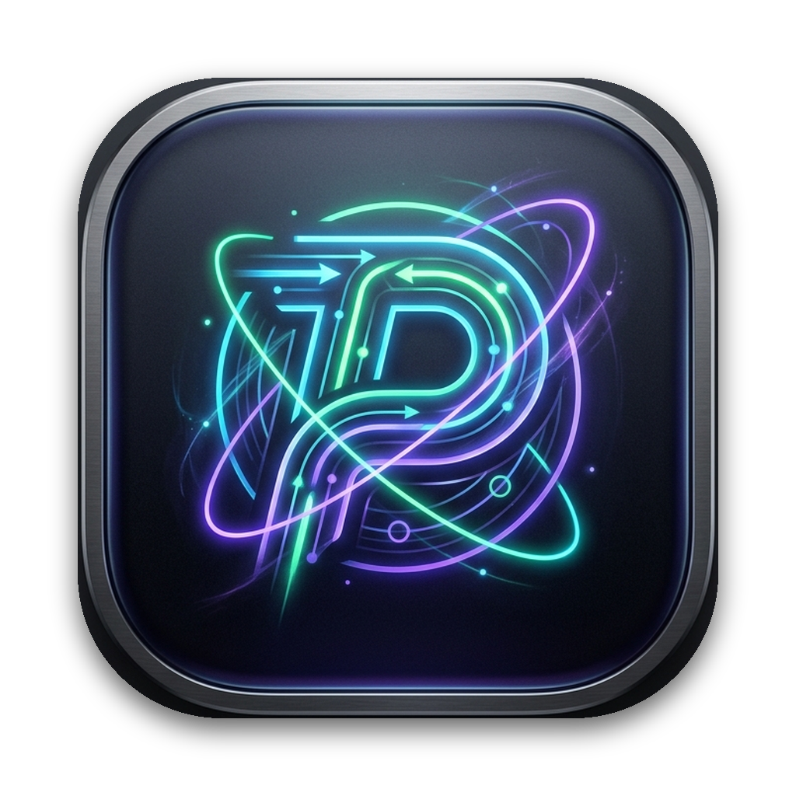

<div align="center">
  
  <h1>Pulsar</h1>
  <p><strong>The pulsing heart of native gRPC testing on macOS.</strong></p>
  <p>⚡️ 轻量、极致流畅、完全原生（Swift 6 / SwiftUI / AppKit）的 macOS gRPC 调试与测试客户端。</p>

  <p>
    <a href="#"></a>
    <a href="#"></a>
    <a href="#"></a>
    <a href="#"></a>
    <a href="#"></a>
  </p>
</div>

---

## 🌟 为什么做 Pulsar？(Why Pulsar?)

许多传统跨平台 gRPC 测试工具或大型通用 API 客户端往往面临着启动缓慢、动辄占用数百兆内存、多级目录 Proto 引用配置繁琐、界面排版粗糙容易变形等痛点。

**Pulsar** 专为 macOS 开发者打造，完全基于 **Apple 原生技术栈（Swift 6 + SwiftUI + AppKit）** 进行架构设计与编码。界面交互与设计体验对标 **[usebruno/bruno](https://github.com/usebruno/bruno)** 的精简理念——**极简卡片、紧凑分栏、层级折叠清晰、告别冗余空白、离线优先与毫秒级响应**。

### 📊 性能与体验对比

| 核心指标 | 传统跨平台工具 | 大型通用 API 客户端 | **Pulsar (Native macOS)** |
| :--- | :--- | :--- | :--- |
| **运行时架构** | 网页容器运行时 | 复杂臃肿运行时 | **100% Native Swift 6 + AppKit** |
| **冷启动速度** | ~3.8 秒 | ~5.2 秒 | **⚡️ < 0.15 秒（闪电冷启）** |
| **常驻内存占用** | 420 MB - 680 MB | 550 MB - 1.2 GB | **🍃 ~28 MB（极低内存）** |
| **应用包体积** | ~180 MB | ~240 MB | **📦 4.2 MB（极小体积）** |
| **ProMotion 刷新率** | 易丢帧卡顿 | 易掉帧 | **✨ 原生 120Hz 丝滑渲染** |
| **多级 Proto Import** | 手动逐个引用，易丢失 | 局限 | **自动递归扫描与 `-I` 路径智能解析** |
| **Proto 扩展与选项** | 忽略 | 无法呈现 | **内嵌解析规则，支持扩展字段映射** |
| **微服务注册中心** | 不支持 | 不支持 | **内置 Nacos 服务发现协议解析 (`nacos://`)** |

---

## ✨ 核心特性 (Key Features)

### 1. 完整 gRPC 4 大调用模式支持
- **Unary（一问一答）**：单次请求与响应，支持耗时分析（DNS、TCP、TLS、TTFB、流传输）。
- **Server Streaming（服务端流）**：实时事件流时间线观察、逐帧接收与查看。
- **Client Streaming（客户端流）**：支持多事件发送与最终结果聚合。
- **Bidirectional Streaming（双向流）**：全双工实时交互气泡，时间线精准记录每一条上行与下行消息。

### 2. 深度 Proto 引擎与多级 Import 路径解析
- **智能 Import 解析**：自动识别 Proto 声明中的 `import "common/types.proto"`，结合配置的多个包含目录（`-I` / `--proto_path`）自动定位依赖。
- **Proto 扩展与选项 (Extensions & Options)**：深度提取并在用例中应用 Proto 注解规则（如 `google.api.http` 等自定义选项）。
- **一键 Mock Payload 生成**：基于已解析的 Proto Message 契约，自动递归生成结构化 Mock JSON 数据。

### 3. Bruno 风格精致 UI 与交互布局
- **自适应卡片设计**：彻底告别 macOS 系统表单在窄屏下的错位排版。TLS 配置、服务发现、超时控制均采用 Bruno 风格独立圆角卡片，任意分栏比例下均保持优雅整齐。
- **多层级请求集合与文件夹折叠**：支持 Collection 与多层级 Folder 自由折叠/展开，一键新建请求与文件夹，树形分明。
- **紧凑无冗余菜单栏**：左侧紧凑选项卡自适应内容宽度，零多余空白；右侧一体化集成 gRPC 状态码徽章、毫秒级时延与传输尺寸。
- **动态分栏切换**：支持左右并排（HSplitView）与上下并排（VSplitView）一键切换。

### 4. Bruno 风格层级配置与继承体系 (Hierarchical Inheritance)
- **集合/文件夹级共享请求头**：可在集合或文件夹设置中配置全局共享 Metadata（如 `x-tenant-id`、`x-client-version`），子请求自动合并并支持同名 Key 独立覆盖。
- **默认身份认证继承 (Auth Inheritance)**：请求默认采用 `继承上级 (Inherit)`，逐级回溯（`Request -> Folder -> Collection -> None`），无需为每个用例重复输入 Token；亦可一键转为独立覆盖。
- **默认 TLS 与超时继承**：集合统一配置 TLS 模式与超时时限，用例默认遵循集合设定。

### 5. 强大的变量插值、诊断与多环境管理
- **动态内置变量**：支持 `{{$uuid}}`、`{{$timestamp}}`、`{{$isoTimestamp}}`、`{{$randomInt(min, max)}}`、`{{$randomAlpha}}`。
- **环境级联解析**：支持 `{{grpc_host}}`、`{{grpc_port}}`、`{{jwt_token}}` 等跨环境无缝插值。
- **生产环境高危警示 (Production Protection)**：支持将生产环境标记为 `PROD`，激活时工具栏显示显眼红色安全警示徽章，防止误操作线上服务。
- **Quick Eye 环境变量多作用域速览**：分类呈现当前环境、全局变量与内置变量，支持实时过滤与一键复制 `{{var}}` 插值语法。
- **变量实时诊断与快捷插入**：地址栏与请求体实时检测未定义的环境变量并给予醒目提示，支持在编辑器中一键弹出变量选择菜单快捷插入。

### 6. Git 友好型多文件目录同步 (Git-Friendly Multi-File Directory Sync)
- **告别合并冲突**：彻底摆脱单文件巨大 JSON 带来的 Git 协同困境。
- **目录结构无损导出/导入**：将集合结构解构为 `collection.json`、`folder.json`、`<name>.grpc.json` 及 `environments/*.json`，可直接与微服务源码一同纳入 Git 版本控制。

### 7. 连接安全与微服务发现
- **全方位 TLS 矩阵**：明文直连 (Plaintext)、标准服务端 TLS、自定义根 CA 证书、双向认证 (mTLS)，搭配原生 `NSOpenPanel` 证书文件选择器。
- **Nacos 服务发现**：支持 `nacos://127.0.0.1:8848/public/service-name?groupName=DEFAULT_GROUP`，自动解析微服务集群实例并负载均衡调用。

### 8. 一键导出 grpcurl 命令行
- 支持将当前请求的所有配置（Address、Metadata Headers、TLS 证书参数、JSON Payload）一键生成为等价的 `grpcurl` 终端命令，方便 CI/CD 复制复现。

---

## 🚀 快速开始与编译 (Getting Started)

### 环境要求
- macOS 14.0 (Sonoma) 或更高版本
- Xcode 15.0+ / Swift 6.0 工具链

### 1. 运行预编译 Release 应用
您可以在本地直接启动打包完成的应用程序：
```bash
open build/Pulsar.app
```

### 2. 从源码编译与运行
```bash
# 克隆仓库
git clone https://github.com/lucklyt/pulsar.git
cd pulsar

# 运行自动化测试 (8 个全覆盖单元测试)
swift test

# 一键编译并打包为原生 macOS .app
./scripts/build_app.sh

# 打开应用
open build/Pulsar.app
```

---

## 🛠 键盘快捷键 (Keyboard Shortcuts)

| 快捷键 | 功能 |
| :--- | :--- |
| **⌘ + Return** | 发送当前 gRPC 请求 (Send) |
| **⌘ + S** | 保存当前请求修改 (Save) |
| **⌘ + N** | 新建 gRPC 请求 |
| **⌘ + T** | 新建请求选项卡 (New Tab) |
| **⌘ + W** | 关闭当前标签页 |
| **⌘ + P** | 打开本地 Proto 仓库与 Import 路径管理 |
| **⌘ + E** | 打开多环境与敏感变量管理弹窗 |

---

## 📂 项目架构 (Architecture)

```text
Pulsar/
├── Sources/
│   ├── Pulsar/                     # 应用入口与可执行文件 (App Executable)
│   │   └── main.swift
│   └── PulsarCore/                 # 核心模块 (Core Framework)
│       ├── PulsarApp.swift         # SwiftUI 原生生命周期与 AppKit 菜单系统
│       ├── Models/                 # 领域模型 (Request, Collection, Environment, Proto)
│       ├── Services/               # 核心服务 (LocalProtoParser, GRPCClientEngine, NacosResolver, StorageManager)
│       ├── ViewModels/             # 响应式全局状态 (AppState)
│       └── Views/                  # Bruno 风格界面组件 (Sidebar, Editor, Inspector, TabBar, etc.)
├── Tests/
│   └── PulsarTests/                # 单元测试矩阵 (Proto 解析、变量插值、Mock 生成、grpcurl 导出)
├── Resources/                      # 图标与多分辨率资源 (AppIcon.icns, icon.png)
└── scripts/
    └── build_app.sh                # 自动化 Release 打包脚本
```

---

## 📄 开源许可证 (License)

本项目基于 [MIT 许可证](LICENSE) 开源发布。欢迎提 Issue、PR 与功能建议！
